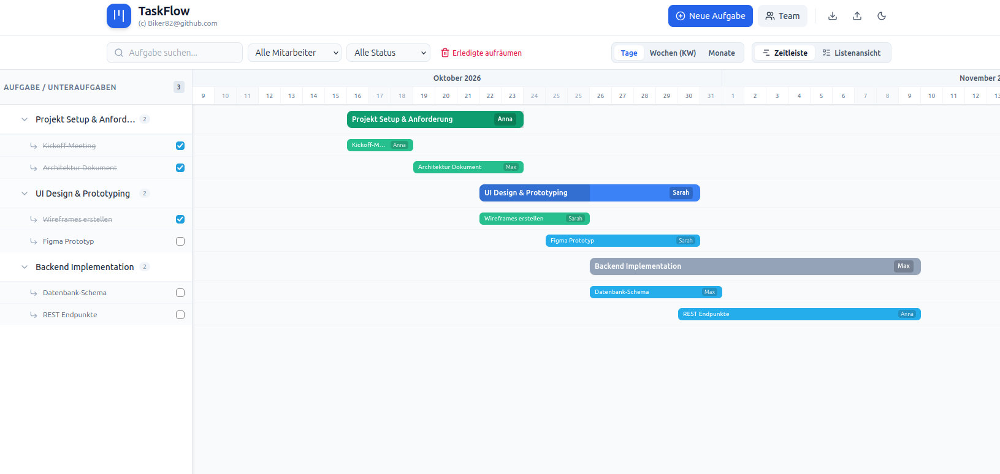
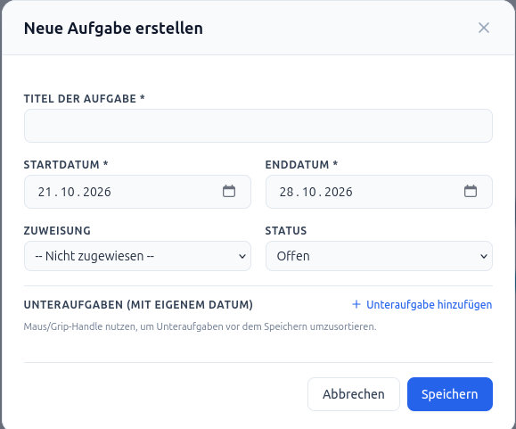
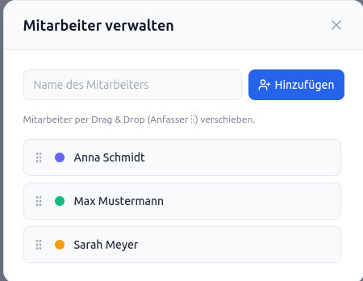

# TaskFlow
&#x1F537; app for managing tasks easily &#x1F537;

#tasks #gantt #projectplanning #projectmanagement

&#x27A1; **Aufgaben eines Teams einfach mit einem Gantt-Diagramm organisieren.**

Bei vielen Aufgaben ist es schwer, den Überblick zu behalten. Vor allem, wenn man ein Team leitet.
Es gibt zahlreiche Software dafür auf dem Markt. Mir waren alle zu unübersichtlich, zu umfangreich, zu teuer und ohne Datensicherheit. Da ich nicht fündig geworden bin, habe ich für mich mit Google Gemini 3 eine eigene App erstellt.

Einfach TaskFlow.html herunterladen und mit dem Browser öffnen. 

*Getestet mit Linux Mint + Firefox 158.0.1 (64-Bit) und Windows 11 + MS Edge*

## Umfang ##
- Team eintragen
- Aufgaben erstellen, ändern, löschen
- Anfangs- und Enddatum der Aufgabe eintragen
- Zuständigen Bearbeiter auswählen
- Arbeits-Status einfügen
- Unteraufgaben erstellen, ändern, löschen
- Zeitleiste per Drag and Drop verschieben
- Ansicht ändern: Tage, Wochen, (Monate)
- Aufgaben nach Bearbeiter filtern
- Aufgaben nach Status filtern
- Dark Mode

**WICHTIG**: 
Da es sich um eine HTML-Datei handelt, werden die Eintragungen nicht gespeichert!

Zum Speichern gibt es eine Export-/ Import-Funktion!

## To Do's ##
An der Anwendung kann noch einiges verbessert werden:

- **bessere Speicher-Funktion**
Eine automatische Sicherung (alle 30 Sekunden) kommt demnächst. Hierbei werden die Einträge in eine übersichtliche JSON-Datei gespeichert.
- Rolle des Bearbeiters im Team eingeben
- Farbe des Bearbeiters ändern
- Ansicht "Monat" verbessern
- Druck-Layout-Ansicht verändern

**Ich freue mich auf Mitarbeit!**

  
