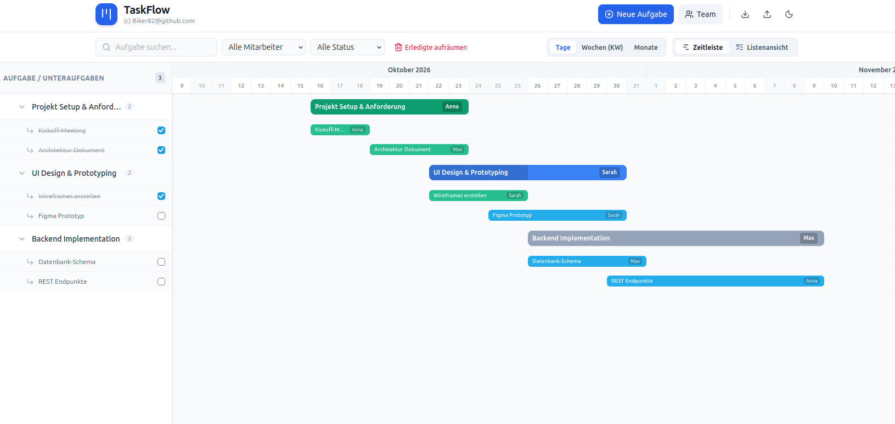
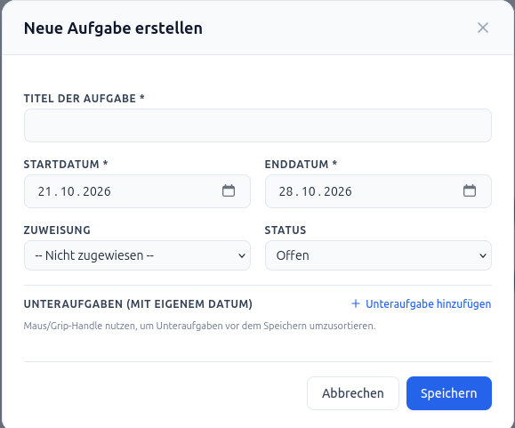
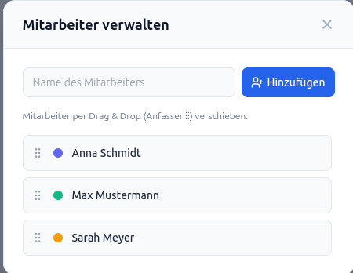
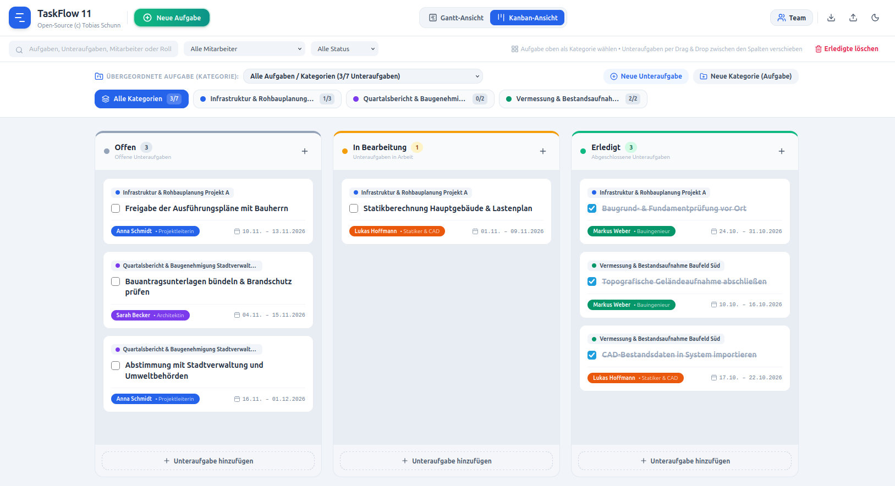
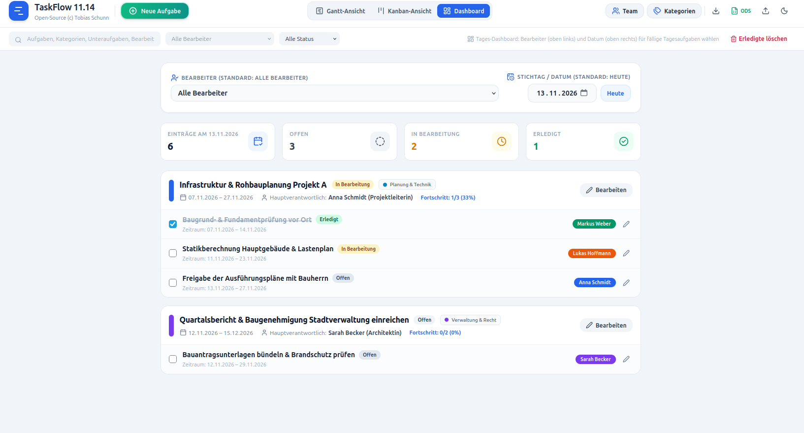
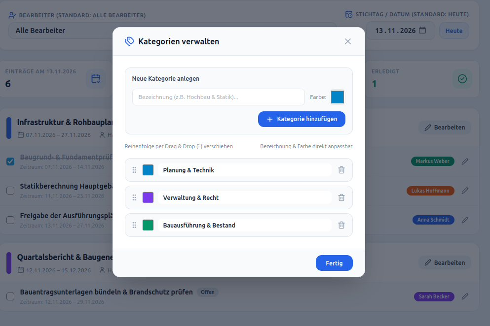

# TaskFlow
&#x1F537; app for managing tasks easily &#x1F537;

#tasks #gantt #projectplanning #projectmanagement

&#x27A1; **Aufgaben eines Teams einfach und sicher organisieren.**

- GANTT-Diagramm
- Kanban-Ansicht
  
*erstellt mit Gemini Argon*

Bei vielen Aufgaben ist es schwer, den Überblick zu behalten. Vor allem, wenn man ein Team leitet.
Es gibt zahlreiche Software dafür auf dem Markt. Mir waren alle zu unübersichtlich, zu umfangreich, zu teuer und ohne Datensicherheit. Da ich nicht fündig geworden bin, habe ich für mich mit Google Gemini eine eigene App erstellt.

**TaskFlow_*.html** herunterladen und mit dem Browser öffnen. 

*Erfolgreich getestet mit Linux Mint + Firefox 158.0.1 (64-Bit) und Windows 11 + MS Edge*

## Umfang ##
- Dashboard-Tages-Ansicht
- Team eintragen
- Aufgaben erstellen, ändern, löschen
- Anfangs- und Enddatum der Aufgabe eintragen
- Zuständigen Bearbeiter auswählen
- Arbeits-Status einfügen
- Unteraufgaben erstellen, ändern, löschen
- Zeitleiste per Drag and Drop verschieben
- Ansicht ändern: Tage, Wochen, (Monate)
- Aufgaben nach Bearbeiter filtern
- Aufgaben nach Status filtern
- Dark Mode

--------------------------------------------

**Ich freue mich auf Mitarbeit!**

--------------------------------------------
