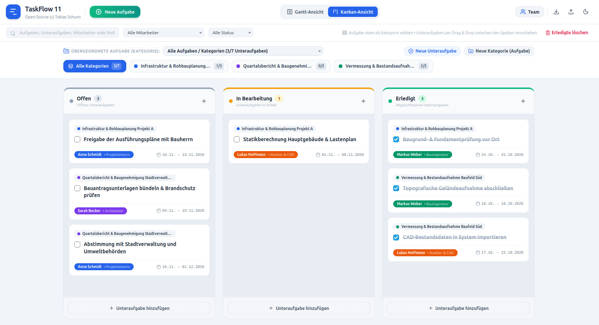

# TaskFlow
&#x1F537; app for managing tasks easily &#x1F537;

#tasks #gantt #projectplanning #projectmanagement

&#x27A1; **Aufgaben eines Teams einfach mit einem Gantt-Diagramm organisieren.**

Bei vielen Aufgaben ist es schwer, den Überblick zu behalten. Vor allem, wenn man ein Team leitet.
Es gibt zahlreiche Software dafür auf dem Markt. Mir waren alle zu unübersichtlich, zu umfangreich, zu teuer und ohne Datensicherheit. Da ich nicht fündig geworden bin, habe ich für mich mit Google Gemini eine eigene App erstellt.

Einfach das Datenpaket als ZIP herunterladen und **TaskFlow_*.html** mit dem Browser öffnen. 

*Getestet mit Linux Mint + Firefox 158.0.1 (64-Bit) und Windows 11 + MS Edge*

## Umfang ##
- Team eintragen
- Aufgaben erstellen, ändern, löschen
- Anfangs- und Enddatum der Aufgabe eintragen
- Zuständigen Bearbeiter auswählen
- Arbeits-Status einfügen
- Unteraufgaben erstellen, ändern, löschen
- Zeitleiste per Drag and Drop verschieben
- Ansicht ändern: Tage, Wochen, (Monate)
- Aufgaben nach Bearbeiter filtern
- Aufgaben nach Status filtern
- Dark Mode

## Version 11 ##
- Kanban-Ansicht für Unteraufgaben ergänzt
- die Eingaben werden nun automatisch alle 30 Sekunden im lokalen Ordner des Users / Browsers gesichert
- Auswahl Rolle des Bearbeiters im Team ergänzt
- Farbe des Bearbeiters ändern
- Ansicht "Monat" verbessert
- Ansicht Quartal ergänzt

 ## To Do's ##
An der Anwendung kann noch verbessert werden:

- Zoom in Gantt-Diagramm
- Druck-Layout-Ansicht verändern

--------------------------------------------

**Ich freue mich auf Mitarbeit!**

--------------------------------------------
  
## Alte Versionen ##
- 9.2  Basisversion
- 9.6  Einfügen von Autosave für File System Access API (Edge)
